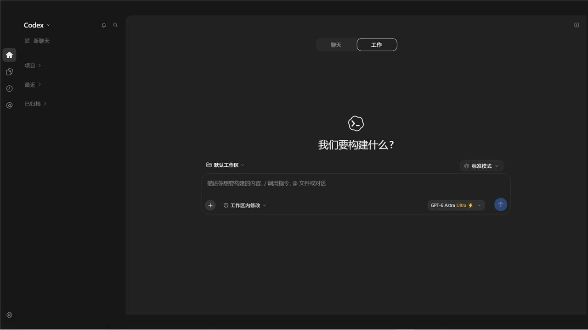

# dsh-codex-ui

DeepSeek Harness 的 Codex 风格 UI 插件（MIT，上游 `Loliyer520/dsh-codex-ui` 的衍生版），适配 **0.2.0-rc.2 Web**（CHANGELOG 另记录对照过 0.2.1-rc.2）；本包不声明 DSH 版本范围——DSH 的兼容门只认 `peerDependencies`，写死版本会让别的 DSH 版本装不上，兼容性改由实测对照保证（理由见〈安装前须知〉）；除界面外，还带一套通过系统提示词注入的编排契约——派发动作由模型按契约执行，插件本身不调用子代理工具。

> **本包是完整版，输入框右下角那一整块（模型选择器 + 推理强度条 + 流星）都在里面，装上它不需要再装别的。** 另有独立插件 `dsh-codex-ui-reasoning`，给不想要整套 Codex 界面、只想要那个模型选择与强度条的人单独使用：它自带样式表、根属性与注入层，只装它也能工作。两者面板是同一份代码，都注册 `conversation.input.model` 这个**单一类槽位**（`priority: -10`），同时启用必有一个注册被拒，所以是二选一，不要同装。早期拆包版曾声明「必须一起装」，该叙述已作废——本仓库主干已把面板合回主包，时间线见 **[MIGRATION-2.0.zh.md](MIGRATION-2.0.zh.md)**。



*界面预览：新对话页——左侧是插件重绘的侧栏；会话区顶部居中是聊天 / 工作两个页签（截图时选中「工作」，即默认值）。*

> **关于本项目**：这是 [Loliyer520/dsh-codex-ui](https://github.com/Loliyer520/dsh-codex-ui) 的衍生版本（MIT），在其基础上继续开发：新增 Ultra 档与闪电编排两套提示词契约、强制中文、会话重命名、已归档会话删除、子代理/分支分组，并修掉了一批缺陷。**与 OpenAI 无隶属或背书关系**；随包分发的 Codex 图标与 OpenAI Sans 字体属于 OpenAI，授权与风险见 [THIRD-PARTY-NOTICES.md](THIRD-PARTY-NOTICES.md)。

## 3.1.0 更新了什么

- **模式三选一互斥**：标准/闪电/超快只注入对应的一份编排合同，每轮开头声明当前模式，旧合同作废，不再串味。
- **超快合同自包含**：不再依赖闪电段拼装，树状派工的规则一条不少。
- **人设真正生效**：修掉了「人设正文从来没进过系统提示」的底层缺陷，现在正文每轮随上下文送达，档案名不再被当成自称。
- **事实核查**：新增独立开关，先查再答、查不到就问、不猜。
- **委派深度装上自动补 2**：子代理可以再派一层孙代理（超快的两层树能落地），已有配置不会被覆盖。
- **想完再答**：开关语义修正——开是想完一次说清，关是像原生那样边想边写。
- **提示音/配色/档位**：子代理完成不再误响；触发条档位名跟弹层同色；推理强度档位改为 Off/Low/High/Max。
- **子代理会话自动清收**：默认关闭，需要的人在配置里显式开启（会附带「后代计数不回退」的已知代价说明）。
## 3.0.0 的三个大件

**一、会话说改就改。** 每条回复、每条思维链旁边多一个入口，点开就能改写，改完写回会话记录。写回的是宿主认得的原始事件，不是盖在页面上的一层显示——重开、刷新、模型再读上下文，看到的都是改过的那句。原来独立的 `dsh-codex-ui-HF`（回复锻造）已并入本包。

**二、侧边栏交给 Agent 管。** 原本写死的五颗按钮下面多出一块可扩展区。对 Agent 说一句「帮我增加侧边栏」，它读完说明书会先问你想让按钮点下去做什么，再动手装——四类目标：切到某个面板、打开设置里的某一页、打开一个网址、启动电脑上的程序或文档。侧栏最多三颗（内置五项另算，合计最多八个），其余收进「更多」里那张表，随时换上来、藏起来、删掉。链接和程序由 DSH 宿主进程去打开，所以在浏览器里用界面时 `steam://` 这类协议、`D:\qq\QQ.exe` 这种程序一样唤得起来。说明书两份：[SIDEBAR-RAIL.zh.md](SIDEBAR-RAIL.zh.md) 给 Agent，[SIDEBAR-RAIL-USER.zh.md](SIDEBAR-RAIL-USER.zh.md) 给人。

**三、DSH 能控制这台电脑。** 截屏、看窗口、移动指针、点击、键入、滚动、拖拽都行，控制期间屏幕顶部有一条提示，第二行实时写着当前目标（比如「正在点击 (320, 480) · 记事本」）。原来独立的 `dsh-computer-use` 已并入本包，配置 `computerUse.enabled: false` 可以关掉，不写就是开着。


- **侧栏**：紧凑会话列表、项目与最近会话分组、置顶（调用宿主 workspace 接口）、悬浮预览卡、重命名、归档（宿主能力）与**永久删除**（仅限已归档会话）、子代理 / 分支分组。
- **会话改写**：每条回复与每条思维链旁有入口，点开改写后写回会话记录（写的是宿主认得的原始事件，重开与重载都保留）；思维链的改写记录在本地重放，被宿主重绘覆盖时补回去。原 `dsh-codex-ui-HF` 并入本包。
- **自定义侧边栏**：内置五颗按钮下方开放最多三格给自定义快捷项，四类目标（面板 / 设置页 / 网址 / 本机程序或文档），带图标的悬停说明、显示与隐藏、两段式确认的删除；条目可由 Agent 通过 `sidebar_rail` 工具增删，也可直接写 `$DSH_HOME/dsh-codex-ui-rail.json`，界面 15 秒内自己同步。
- **模型面板**（面板 UI、滑条与流星都在本包内；`dsh-codex-ui-reasoning` 是同一份面板的独立精简版，二者不要同装）：原生模型与推理强度档位（列表来自宿主）、模型显示名自定义（同时写入"模型身份"提示词段落）、**编排模式三档菜单**（标准 / 快速 / 超快）、滑条末追加虚拟 **Ultra 格**并注入"最严验收"契约、开启编排时披露 token 成本倍率（1.5× / 2.5×）。
- **提示词**：DeepSeek 模式不追加本插件的风格段（宿主原版系统提示词不受影响，中文策略与模型身份段仍生效）；Codex 模式追加"严谨、理性、严肃、简短"的回复规则；强制中文，模型身份段落同时约束思考过程；新对话页有回复风格页签与品牌图标。
- **编排契约**：快速 / 超快已开启的会话里，委派按四条客观条件触发——答案依赖本机没有的事实、改动或判断跨两处以上、两个各自能翻盘的未知、明确要求多角度；四条都不成立时单路做完，并须点名哪条为假。每轮 step 1–3 各注入一条带轮次号的短提醒（step 4 起不再注入）；超快模式下每个**一级**子代理再开两个孙代理，**二级即止**。
- **电脑控制**：截屏、窗口树检查、指针移动、点击、键入、滚动、拖拽；控制期间屏幕顶部常驻提示并实时显示当前目标（如「正在点击 (320, 480) · 记事本」）。原 `dsh-computer-use` 并入本包，配置 `computerUse.enabled: false` 可关（不写即开）。
- **界面与其它**：浅色 / 深色 / 窄窗口适配；超快模式滑条四段暖色递深（minimal·low / high / xhigh·max / ultra 渐变）；努力滑条旋钮 24×24 正圆（常态带投影，超快 + Ultra 态加描边与发光）；字体与图标随包分发（字体以 base64 内联进 `lib/client.js`）；设置菜单显示官方 DeepSeek API 余额（服务端缓存 30 秒，只有校验过的余额字段回到前端），并带刷新 / 控制台 / 设置 / 插件 / 帮助入口。

**当前版本（3.1.0）**：产物 `dsh-codex-ui-3.1.0.tgz`（`npm pack` 生成，不入库）。3.1.0 在 3.0.0 电脑操控并入的基础上，修好人设落地、统一模式注入、补齐委派深度——上一版的三大件（回复锻造（会话改写）、可自定义侧边栏、电脑操控——安装方式没变，装一个包就有全部能力。2.x 的历史要点见 [CHANGELOG.md](CHANGELOG.md)。界面类改动刷新页面即可，提示词契约类与宿主侧改动（侧边栏的链接/程序启动、电脑控制）需要重启 DSH。

## 新对话页：回复风格、标题与图标

新对话（空白会话）页面上有三个由本插件渲染的元素：

- **回复风格页签（聊天 / 工作）**：位于会话区顶部、与品牌图标同一条中线上，选中态是一枚平滑滑动的胶囊。聊天注入"说人话、先回应人"的风格，工作注入"精确、可验证"的风格。因为这时还没有会话 id，选择通过 `/api/dsh-codex-ui/turbo` 以空 sessionId 写成宿主的"下一次选择"，并记录选择时刻；宿主在**该时刻之后才开始的会话**的第一个 turn 上把风格**落章**到那个会话，此后不再改动。因此：选择只作用于当时开的那次对话，进行中的旧会话与其它会话都不受影响；打开页面时页签显示的当前值也会被记为一次选择。默认是"工作"。
- **标题**：`我们要构建什么?`。原生标题来自 `conversation` locale 字典（插件不能重复注册），所以由前端隐藏原生 span、渲染自己的标题元素；当工作区 chip 显示的是真实项目名时，标题后会追加一个项目胶囊（克隆原生 chip，去掉下拉箭头与按钮语义），在默认工作区时不显示。
- **图标**：品牌位换成 DeepSeek 鲸鱼标记，颜色跟随主题。

## Ultra 档与闪电编排

模型面板（输入框里的模型选择器，由本包渲染）上有两个提示词层的开关，注入由宿主半边的 `agent/pre-step` 按会话精确执行：

- **Ultra 档**：滑条末尾追加一格 `Ultra`（模型自带 `ultra` 档时直接用该真实档）。选中时写回模型**真实的最高档**，`ultra` 从不作为推理档 id 下发；同时注入"最严验收"契约——先定验收标准、证据先于断言、对抗式复查、根因优先、显式停止条件、不许改测试迁就实现。界面进入 Ultra 时轨道有流星特效。
- **闪电编排**：点面板左上角那枚闪电启用。注入的编排契约按四条条件判断是否派发；成立时要求父 agent 在**同一条消息里派两个角度不同的子代理**，按角度而不是复制切分，每个子代理提示词自包含，父 agent 只做编排与整合；正文末尾带防递归守卫，子代理不会继续派活。

两个开关按会话记录在 `$DSH_HOME/storages/`（最多 40 个会话）：2.0 起拆成 `codex-ui-persona.json` 与 `codex-ui-effort.json`，旧的 `codex-ui-turbo.json` 只用于一次性迁移；写入方是副包，本包只读。读取仍通过 `/api/dsh-codex-ui/turbo`（写侧对推理档位相关字段返回 `turbo/effort-moved`）。关闭时会补一条一次性"模式已关闭"提示，避免历史里那条契约继续生效。这是提示词层的能力，不会给模型加算力；闪电会显著增加 token 消耗。

## 安装

三种方式任选其一；三种方式装到同一个 profile，都需要**重启 Harness** 才会加载。

**A. 本地 tarball（不依赖 registry，最快）**

拿到 `dsh-codex-ui-3.1.0.tgz` 后，在 DSH **插件 → 添加插件**里填该文件的绝对路径，或：

```powershell
dsh plugin --profile <profile名称> add 'C:/路径/dsh-codex-ui-3.1.0.tgz'
```

**B. npm**

```powershell
dsh plugin --profile <profile名称> add dsh-codex-ui@3.1.0
```

> ⚠️ **这个包目前还没有发布到 npm**（公共 registry 上会返回 404）——现在执行上面这条会失败，首次安装请用 A 或 C 方式。若你打算发布到 npm，这条命令在发布满 24 小时后即可用。

DSH 插件页只会安装**发布满 24 小时**的版本，因此首次安装请带上版本号。

**C. 仓库 / 本地目录**

下载或克隆仓库后，可以交给启动脚本，也可以直接指向目录：

```powershell
git clone https://github.com/jiangshen275-beep/DSH-Codex-ui-2-.git
cd dsh-codex-ui
.\start-ui.ps1
```

启动脚本默认使用本机 `.dsh-win/versions/0.2.0-rc.2/dsh.cmd`，创建独立的 `codex-ui` Web profile，并打开端口 3088。也可指定位置和端口：

```powershell
.\start-ui.ps1 -Dsh 'C:/路径/dsh.cmd' -Profile codex-ui -Port 3089
```

安装到已有的自定义 Web profile：

```powershell
dsh plugin --profile <profile名称> add 'file:C:/路径/dsh-codex-ui'
```

从 `dsh-chatgpt-ui` 迁移时，先移除旧插件，再安装本包；启动脚本会自动完成此步骤。

```powershell
dsh plugin --profile <profile名称> remove dsh-chatgpt-ui
```

### 安装前须知

- **本插件强制中文**：装上之后，被注入的会话都会用中文思考并作答（代码与路径等保持原样）；只有该轮明确要求另一种语言时才例外。不想要这个行为，把 `src/turbo.js` 里的 `FORCE_CHINESE` 改成 `false`。
- 本插件通过 `cordis.patch.yml` **禁用内置 `ui-sidebar`** 并插入自己的侧栏（右侧栏仍由宿主提供，本插件不接管）；这会改变界面结构。想先试用，请装到一个独立 profile。
- **已知限制**：插件管理页里的启用/停用开关**对本插件无效**——它是以自定义 id 插入的，页面按包名写开关。要停用请从 profile 的 `cordis.patch.yml` 里移除对应的插入条目，或直接卸载。
- 本包**不声明 DSH 版本范围**：DSH 的插件兼容门只读 `peerDependencies`（`dsh-app-boot` 按 `includePrerelease` 判 semver，且不读 `peerDependenciesMeta`，所以标 `optional` 也不免除拦截），写死 `0.2.0-rc.2` 会让别的 DSH 版本装不上、必须逐个 `allow-version` 精确豁免（1.1.0 那版就如此）；兼容性因此由实测对照保证——CHANGELOG 记录对照过 0.2.0-rc.2 / 0.2.1-rc.2。CSS 依赖参考版本的类名，升级 DSH 后需要重新校验。
- **装上会自动把子代理委派深度补到 2**：首次启动时插件检查 profile 的 `cordis.yml` / `cordis.patch.yml`，若两处都没有 subagent 段的 `maxDepth`，会先备份 patch 再把 `maxDepth: 2` 追加进去（已有配置则一个字不动）。子代理因此可以再派一层孙代理——超快模式的两层树要靠它才落得了地。这一步改的是宿主配置，**需要再重启一次 DSH 才生效**；诊断接口 `GET /api/dsh-codex-ui/subagent-depth` 可查看当前读到多少。
- 包内包含 `src/`：`lib/index.js` 运行时导入 `../src/*.js`，因此不要只发布 `lib/`。
- 变更记录见 [CHANGELOG.md](CHANGELOG.md)。


## 开发

仓库包含已构建的 `lib/client.js`，安装插件无需重新构建。修改源码后执行：

```powershell
npm install
npm run build
npm run check
npm test
```

测试需要本机安装参考版本的 DSH；可通过 `DSH_RUNTIME_PACKAGES` 指定其 `node_modules/.pnpm` 目录。

## 卸载

```powershell
dsh plugin --profile codex-ui remove dsh-codex-ui
```

重启后恢复原生侧栏。**注意**：卸载不会回滚上面那条自动补的 `maxDepth: 2`——它写在 profile 配置里，要恢复就把 `cordis.patch.yml` 里那段 `- id: subagent` 删掉再重启。仅验证过 Web；CSS 部分依赖参考版本的类名，升级 DSH 时需要重新校验。定时任务页面目前只保存本地草稿。Codex 模式仅改变提示词风格，不会将 DeepSeek 模型变为 OpenAI 模型。

侧边栏快捷项：用户怎么用见 [SIDEBAR-RAIL-USER.zh.md](SIDEBAR-RAIL-USER.zh.md)，交给 Agent 装见 [SIDEBAR-RAIL.zh.md](SIDEBAR-RAIL.zh.md)。

提示词说明见 [SYSTEM-PROMPT-PLAN.zh.md](SYSTEM-PROMPT-PLAN.zh.md)，本机资源定位方法见 [RESOURCE-REFERENCE.zh.md](RESOURCE-REFERENCE.zh.md)。第三方图标和字体的来源见 [THIRD-PARTY-NOTICES.md](THIRD-PARTY-NOTICES.md)。本项目为个人界面插件，与 OpenAI 无隶属关系。
